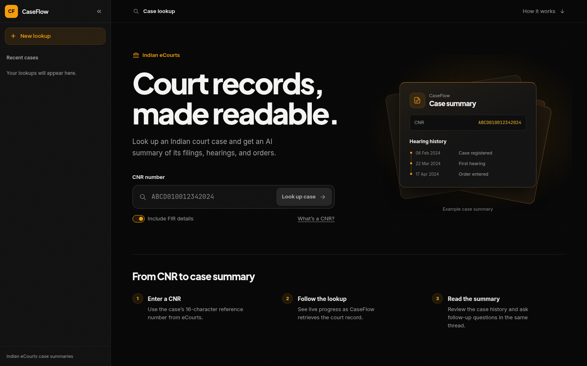
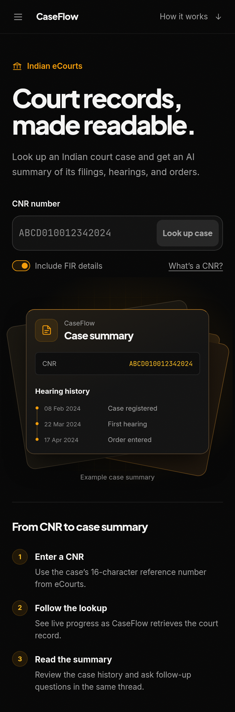
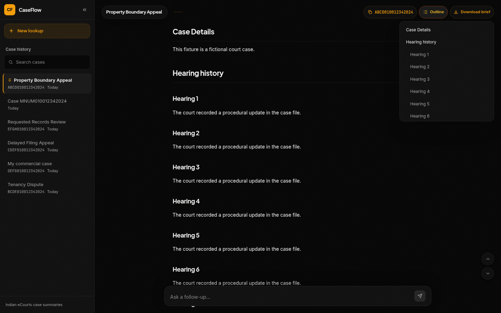
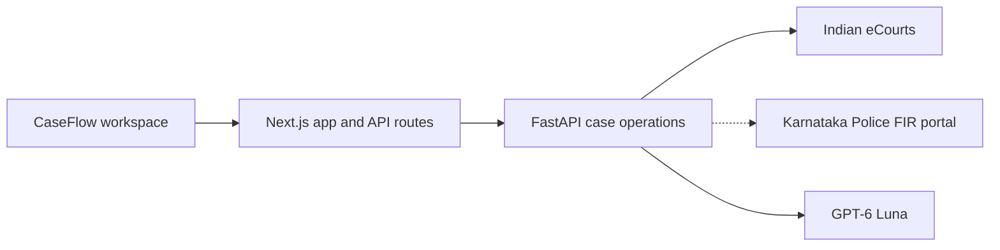

# CaseFlow

**Court records, made readable.**

Look up an Indian court case by its CNR, follow the live retrieval progress, and read a summary of the filings, hearings, and orders. Keep the case in a searchable workspace where you can ask follow-up questions and export the summary as a Markdown brief.

[Features](#features) · [Run locally](#run-locally) · [Architecture](#architecture) · [Checks](#checks)



<details>
<summary>Mobile view and case workspace</summary>

| Mobile lookup | Case workspace |
| --- | --- |
|  |  |

The screenshots show example cases.

</details>

## Features

- **Case lookup.** Enter the 16-character case reference number (CNR) from Indian eCourts. Include FIR details when needed and follow any prompts for additional input.
- **Live summary and follow-ups.** Watch the record retrieval and summary as they stream. Ask questions in the same case, or stop and retry a lookup without starting a new thread.
- **Searchable history.** CaseFlow generates a descriptive title when the summary finishes and preserves manual renames. Search by title or CNR, and pin cases for quick access.
- **Reading and export.** Jump between sections with the summary outline, copy the CNR, or download a Markdown brief. The interface supports keyboard navigation and reduced motion.

## Run locally

You’ll need **Node.js 20.9 or later**, **Python 3.13 or later**, **uv**, and an **OpenAI API key** with access to `gpt-6-luna`.

Clone the repo and copy the environment template.

```bash
git clone https://github.com/couldbeharshith/case-history-app.git
cd case-history-app
cp .env.example .env
```

Set `OPENAI_API_KEY` in the root `.env` file.

### Start the backend

From the repository root, run this in one terminal.

```bash
cd backend
uv sync --locked
uv run playwright install chromium
HEADLESS=1 uv run uvicorn api:app --host 127.0.0.1 --port 8000 --reload
```

### Start the frontend

From the repository root, run this in a second terminal.

```bash
cd frontend
npm ci
npm run dev
```

Open [CaseFlow on localhost](http://localhost:3000) and enter a CNR.

### Configuration

| Setting | Where to set it | Purpose |
| --- | --- | --- |
| `OPENAI_API_KEY` | Root `.env` | Enables summaries, follow-up answers, and generated titles. |
| `HEADLESS` | Root `.env` or backend shell | Set to `1` to run Chromium without opening a window. |
| `BACKEND_URL` | `frontend/.env.local` or frontend shell | Points Next.js at FastAPI. Defaults to `http://localhost:8000`. |

## Architecture



Next.js owns the workspace and relays progress and text from FastAPI over Server-Sent Events. The backend coordinates Playwright lookups, optional FIR retrieval, and summary generation. Completed conversations are saved locally. The frontend stores workspace history under `frontend/chat-data/`, while the backend stores case context under `backend/data/<chat-id>/`.

## Checks

Run these from the repository root after installing dependencies.

```bash
(cd backend && uv run python -m unittest discover -s tests)
(cd frontend && npm run lint && npm run build)
```

The backend tests use fixtures for streamed lookups, storage compatibility, interrupted requests, and title generation.
